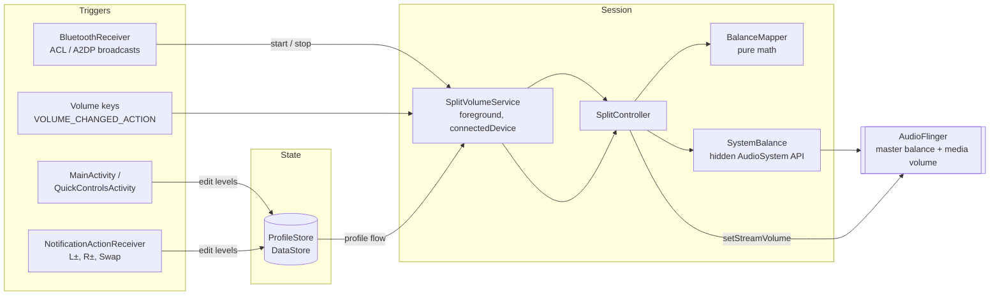
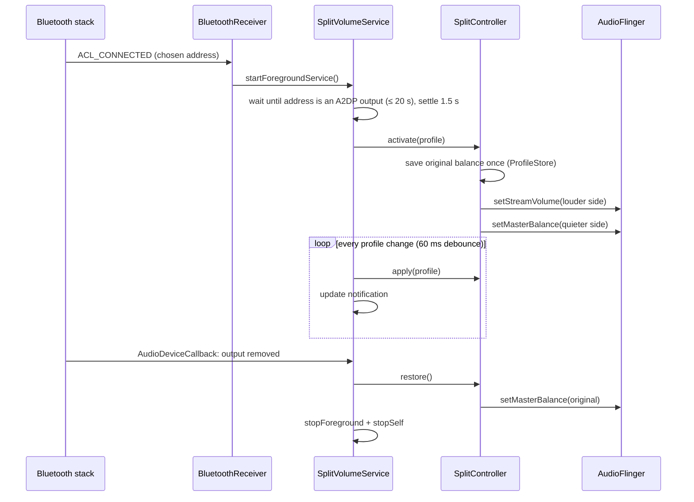

# Architecture

Split Volume is a single-module Android app (`:app`) written in Kotlin with Jetpack Compose. It has no network
access, no analytics, and no dependencies beyond AndroidX, DataStore and
[HiddenApiBypass](https://github.com/LSPosed/AndroidHiddenApiBypass).

## Big picture

**Main rule: the UI and the notification never touch audio directly.** They only edit the stored
`Profile`. While the session runs, `SplitVolumeService` collects the profile flow and applies every change through
`SplitController`. So there is exactly one place that changes audio state.

## Source map

All paths are under `app/src/main/java/dev/yaelrdf/splitvolume/`.

| File | Role |
|---|---|
| `SplitVolumeApp.kt` | `Application`. Owns the singletons `store` (`ProfileStore`) and `controller` (`SplitController`), reachable via `context.app`. Creates the notification channel. |
| `Profile.kt` | `Side` (L/R), `Profile` (device + levels), `SavedSystemState`, and `ProfileStore` (DataStore persistence). |
| `BalanceMapper.kt` | Pure functions: L/R levels → media-volume index + master balance, including the measured AudioFlinger balance curve. Unit-tested. |
| `SystemBalance.kt` | Thin wrapper over the hidden `android.media.AudioSystem.{set,get}MasterBalance` and `getMasterMono`. `create()` returns `null` if the phone blocks them. |
| `SplitController.kt` | Applies a `Profile`: media volume follows the louder side, balance attenuates the quieter one. Saves and restores the phone's original balance. Handles volume-key rescaling and the test beep. Exposes `state: StateFlow<State>` for the UI. |
| `SplitVolumeService.kt` | Foreground service (`connectedDevice`) that lives exactly as long as a session. Waits for the earbuds to become the media route, activates, keeps applying profile changes, and restores on disconnect. |
| `BluetoothReceiver.kt` | Manifest receiver for `ACL_CONNECTED`, `ACL_DISCONNECTED` and A2DP connection-state broadcasts. Starts or stops the service for the chosen device only. |
| `ConnectionSync.kt` | `syncWithConnection()`: called when a UI screen resumes, so the session starts if the earbuds are already connected, or a balance left by a killed session gets restored. |
| `AudioRoutes.kt` | Helpers to check whether a given Bluetooth address is currently an audio output. |
| `Notifications.kt` | Channel, status notification, the L/R control notification (custom `RemoteViews`), and the "tap to activate" prompt. |
| `NotificationActionReceiver.kt` | Handles the notification's −/+ and Swap buttons by editing the stored profile. |
| `TonePlayer.kt` | Plays a short one-channel beep (`Ping L` / `Ping R`). |
| `ui/MainActivity.kt` | Main screen: status, sliders, Setup card (permissions, device choice, Mono audio status, background). |
| `ui/QuickControlsActivity.kt` | Small dialog with sliders, opened from the notification. |
| `ui/VolumeControls.kt` | Shared composable for the L/R sliders + `statusText()`. |
| `ui/Theme.kt` | Material 3 dynamic color theme. |

Debug-only: `app/src/debug/java/dev/yaelrdf/splitvolume/DiagReceiver.kt`. It's an exported receiver for poking
audio calls from adb, and it isn't included in release builds. See [debugging.md](debugging.md).

## Session lifecycle

### Starting from the background

Android 12+ blocks most foreground-service starts from the background. The session can still start because:

- a broadcast that requires `BLUETOOTH_CONNECT` (like `ACL_CONNECTED`) is an exempt trigger, and
- a CompanionDeviceManager association, made via **Choose** in Setup, grants
  `REQUEST_COMPANION_START_FOREGROUND_SERVICES_FROM_BACKGROUND`.

If the start is still refused, the receiver posts a **"Headphones connected, tap to turn on"** notification instead.

### If the OS kills the app mid-session

The balance lives in AudioFlinger, not in the app process, so it survives the app being killed. To avoid leaving
the phone lopsided:

- the original balance is stored in DataStore (`original_master_balance`) before the first change,
- `hasPendingRestore()` is true while that key exists,
- the next disconnect broadcast or UI resume calls `restore()`, and
- a reboot clears AudioFlinger's balance anyway, because the value set this way is never persisted.

## Level model

Each side has a level 0–100 (`Profile.left`, `Profile.right`). `BalanceMapper.map()` turns that into:

- **media volume index** = the louder side's level, scaled to the stream's range (ColorOS uses 0–160);
- **quieter side gain** = (quiet / loud)², so half the slider sounds about half as loud (≈ −12 dB);
- **master balance** = `balanceForGain(gain)`, inverting AudioFlinger's measured curve
  `gain = (x + 5x²) / 6` with `x = 1 − |balance|`. Positive balance turns **L** down; negative turns **R** down.

**Volume keys:** when STREAM_MUSIC changes and it wasn't our own write (800 ms echo window),
`onExternalVolumeChange()` rescales both sides by the same factor, which keeps their ratio.

## Persistence (DataStore `split_volume`)

| Key | Meaning |
|---|---|
| `device_address`, `device_name` | The chosen earbuds |
| `left_<ADDRESS>`, `right_<ADDRESS>` | Levels, stored per device |
| `original_master_balance` | Balance before the session; present ⇒ a restore is pending |

Older builds also wrote `mono`, `use_effect` and `original_master_mono`. They're ignored now and harmless.

## Permissions

| Permission | Why |
|---|---|
| `MODIFY_AUDIO_SETTINGS` | Required by AudioFlinger for `setMasterBalance` (normal permission, auto-granted) |
| `BLUETOOTH_CONNECT` | Read device address/name, receive ACL broadcasts |
| `POST_NOTIFICATIONS` | The control notification |
| `FOREGROUND_SERVICE`, `FOREGROUND_SERVICE_CONNECTED_DEVICE` | The session service |
| `REQUEST_COMPANION_*` | Start/run from background after a companion association |
| `REQUEST_IGNORE_BATTERY_OPTIMIZATIONS` | Lets the Setup card ask for an exemption |
